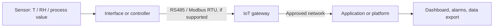

# Industrial IoT Sensor Integration

A learning repository describing how industrial sensor data can travel from a sensor through an interface or controller to a gateway and application. This is a **conceptual reference**, not a claim of a completed field deployment.

## Purpose
Understand the layers in a typical industrial IoT monitoring solution and the questions to resolve during integration.

## Reference architecture



Each device must support the chosen interface and protocol. A gateway does not automatically translate every sensor protocol.

## Integration checklist
1. Identify the exact sensor model, measured variable, range, units, supply, and output.
2. Confirm interface and protocol from the official datasheet.
3. Verify wiring, grounding, isolation, and environmental requirements against manufacturer instructions.
4. For Modbus devices, confirm address, baud rate, parity, stop bits, register map, scaling, and byte/word order.
5. Define gateway network settings and data destination with the system owner.
6. Validate values against a trusted reference where appropriate and record test conditions.
7. Document alarms, failure modes, maintenance, and recovery steps.

## Example data (illustrative only)
```json
{
  "device_id": "demo-sensor-01",
  "temperature_c": 23.4,
  "relative_humidity_percent": 46.2,
  "timestamp": "2026-01-01T10:00:00Z",
  "data_status": "illustrative"
}
```
These values are sample data, not a real installation.

## Troubleshooting
- **No data:** check power, physical interface, protocol compatibility, address, and gateway logs.
- **Intermittent serial communication:** inspect cable routing, termination/biasing design, topology, baud/parity, and grounding per device documentation.
- **Plausible but incorrect readings:** check units, scaling, register mapping, sensor placement, and calibration status.
- **Data visible locally but not remotely:** inspect gateway network configuration, destination endpoint, firewall rules, and timestamps.

## Safety and limitations
Follow site electrical and process-safety procedures. Never connect unknown terminals based only on wire colour. Do not publish customer configurations, credentials, site details, or proprietary company documentation.

## References
- [Modbus specifications](https://www.modbus.org/specs.php)
- [GitHub diagrams in Markdown](https://docs.github.com/en/get-started/writing-on-github/working-with-advanced-formatting/creating-diagrams)

**Status:** Learning/reference documentation. Hardware testing is not claimed.